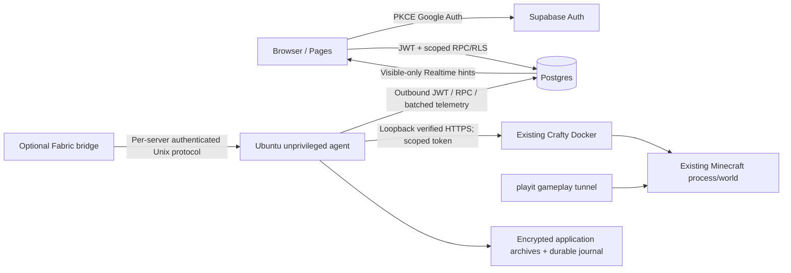

# Architecture, data flow and trust boundaries

Verified handover date: 10 November 2026 (Asia/Singapore). [Start here](00-START-HERE.md) · [Feature evidence](02-FEATURE-STATUS-MATRIX.md) · [Validation](17-HANDOVER-VALIDATION.md)

## Components

Static React/TypeScript/Vite assets deploy through GitHub Actions to GitHub Pages. Supabase JS uses a deliberately public publishable routing key, Auth PKCE and database policies/RPCs. There is no conventional hosted middleware or Edge Function backend in the current design: trusted authorization lives in PostgreSQL private functions behind public invoker RPCs, while the local Python agent is the privileged bridge to Crafty.

The arrow directions describe connection initiation or data flow, not permission to install components. Agent networking is outbound only; the optional local Unix socket is not an Internet listener. Minecraft stays independent when cloud services fail.

## Authority boundaries

Browser role hiding is presentation only. private.allowed and locked RPCs enforce current approved membership/capabilities. Agent Auth identity is separate from human roles and bound to exact server UUIDs. Root-managed local mappings alone choose Crafty UUID/localhost URL/cert/token/paths; editing dashboard endpoint/config metadata cannot reconfigure host execution.

Host control requires private.agents.control_enabled plus local controls_enabled, both false initially. Worker exits before claiming in observation mode and Crafty.execute refuses effects. server_readiness is a permission-checked display summary, not a substitute for dispatch authorization. Readiness requires fresh health and known/fresh snapshots. Queues expire, claim tokens fence results, the journal marks uncertain before dispatch and prevents blind replay.

## Data and failure handling

Agent collects one bounded metrics batch per minute with reconnect backoff; normal command wakeups use Realtime plus a bounded recovery cadence. Browser subscriptions are removed when hidden. Visible fleet events load telemetry only; console/history are not fetched each heartbeat. History records at most one real sample per 15-minute bin for roughly one day; idle rows remain bounded until the next update, and queries filter the last day. Missing intervals are null gaps.

Actual online count is independent of sampled player names and protected by players.view RLS. Uptime is unavailable until the exact timestamp timezone contract is verified. Archive-gated deletion acknowledges verified full-row fingerprints only after durable authenticated local encryption/manifests; unresolved commands survive retention. Database and local quotas fail closed, trading availability/storage pressure for preserved evidence.

## Multi-server model

All resources use independent UUIDs; controller UUID, endpoint ID, user ID and Minecraft UUID are different namespaces. Roles/memberships/stats/backups/console/commands are server scoped. One host agent may be explicitly bound to several resources; each has a journal/archive partition and independent loop. Equivalent or duplicate Crafty targets are rejected. Two fixture configurations pass isolation tests without launching game processes. Additional physical servers remain Stage D.
